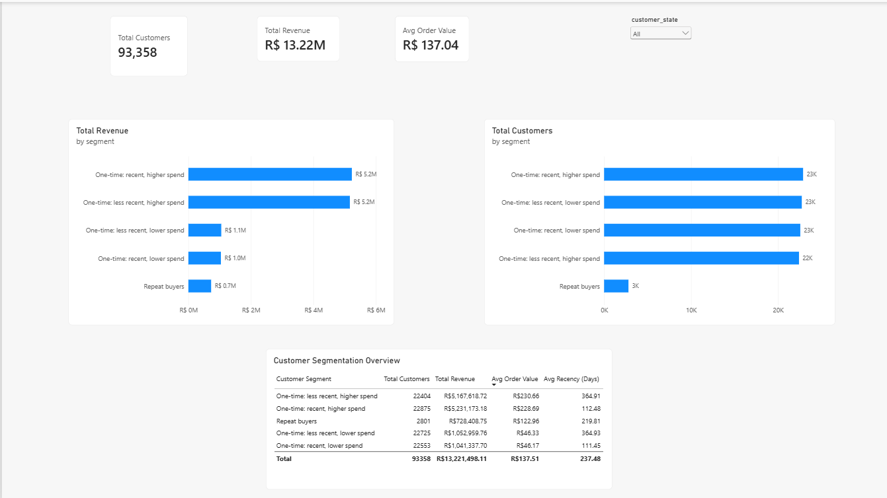
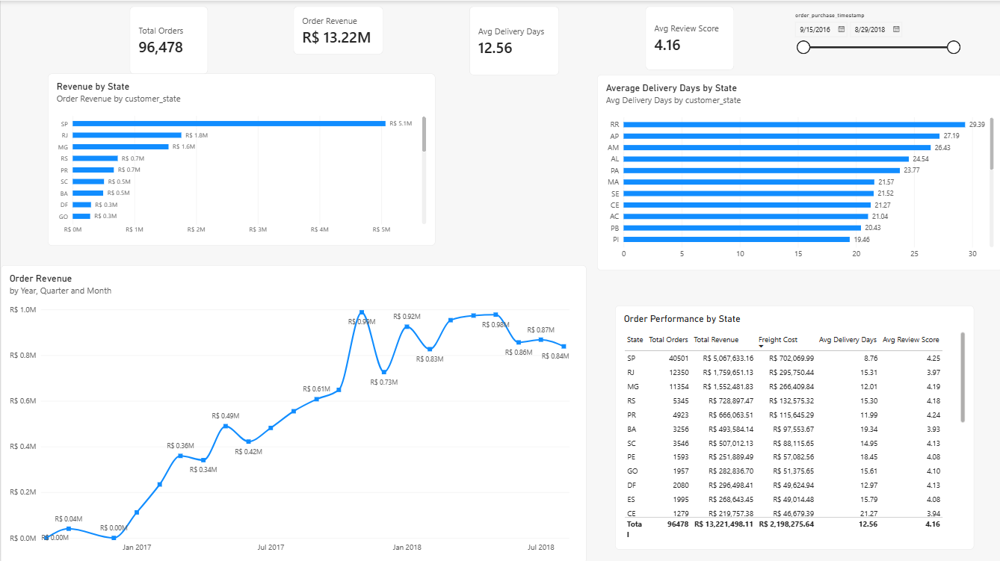
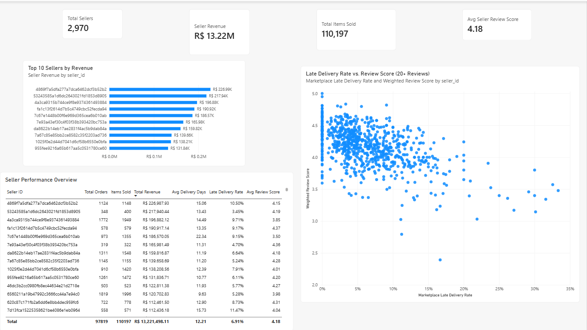

# Brazilian E-Commerce Customer Analytics

**An end-to-end analytics project using Python, PostgreSQL, and Power BI**

## Project overview

This project analyzes the public Olist Brazilian E-Commerce Dataset to understand customer purchasing behavior, repeat purchases, delivery performance, and seller quality. It turns raw marketplace data into reusable analytical tables, a three-page Power BI report, and recommendations that a business could test.

The analysis covers orders purchased from September 2016 through August 2018. It is a historical case study, not a live customer or seller monitoring system.

### Business questions

- Which customer groups contribute most to item revenue, and how common are repeat purchases?
- How do revenue and delivery performance differ by month and state?
- How are seller delivery performance and customer reviews related?
- What retention, logistics, and seller-quality actions are worth testing?

## What I built

1. **Explored and validated source data** in Jupyter notebooks, including table grain, missing values, keys, and relationships.
2. **Engineered order and customer features** in pandas, including recency, frequency, monetary value, average order value, repeat-purchase status, and five interpretable customer segments.
3. **Created PostgreSQL analytics views** for delivered-order performance, customer features, and seller performance. Documented reconciliation against the pandas outputs.
4. **Built a Power BI report** with Customer Segmentation, Order Performance, and Seller Performance pages.
5. **Translated findings into business recommendations** for retention experiments, delivery improvement, and seller monitoring.

## Technologies

- Python: pandas, NumPy, Matplotlib, Jupyter
- SQL: PostgreSQL, views, aggregation, data validation
- BI: Power BI Desktop, DAX measures, interactive report pages

## Key findings

- **Repeat purchasing was uncommon in the observed period:** 2,801 of 93,358 customers with delivered orders purchased more than once (3.00%). Repeat buyers contributed 5.51% of item revenue. This is a historical repeat rate, not a lifetime churn measure.
- **Higher-spend one-time buyers generated most revenue:** two such segments represented about 48.5% of customers and 78.65% of item revenue (approximately R$10.40 million).
- **Revenue was geographically concentrated:** São Paulo, Rio de Janeiro, and Minas Gerais together contributed about 63.38% of delivered-order item revenue.
- **Delivery times differed across regions:** the Power BI order fact averages 12.56 days across 96,470 delivered orders with valid delivery timestamps. Bahia averaged 19.34 days across 3,256 orders, making it a higher-volume improvement opportunity than the most delayed, low-volume states.
- **Seller comparisons need careful interpretation:** the top 10 sellers generated about 13.27% of seller item revenue. Among sellers with at least 20 reviews, late-delivery rates and average review scores had a correlation of about -0.53; this is an association, not evidence of causation.

Revenue is reported in Brazilian reais (R$) and means item price only; it excludes freight, costs, and profit.

## Power BI dashboards

The screenshots let you review the report without opening the PBIX. The report now formats revenue in Brazilian reais (**R$**).

### Customer Segmentation

Customer counts and item revenue by historical segment, with a customer-level segment summary.



### Order Performance

Revenue by state and month, delivery days by state, and an order-performance table.



### Seller Performance

Seller revenue and operating metrics, plus the relationship between seller late-delivery rate and review score.



The [Power BI README](powerbi/README.md) explains how to open the report, refresh its CSV sources, and interpret the dashboard measures. The detailed [business insights and recommendations](powerbi/business_insights_and_recommendations.md) document provides findings and caveats.

## Recommendations

- **Test second-purchase campaigns:** target first-time buyers with relevant follow-up messaging and compare results with a holdout group. Measure incremental repeat purchases and contribution margin, not just clicks or gross revenue.
- **Prioritize logistics investigations by impact:** examine high-volume regions with slower delivery, and separately diagnose extreme delays in low-volume regions before committing resources. Track late-delivery rates and delivery-time percentiles.
- **Monitor seller quality with denominators:** use order and review counts alongside late rates and scores. Investigate patterns with sellers before treating descriptive correlations as causes or using them for penalties.

## Data pipeline

```text
Olist source CSVs
      |
      +--> Python notebooks: data quality, EDA, customer features and segments
      |
      +--> PostgreSQL: raw staging tables --> order, customer and seller views
                                      |
                                      +--> CSV exports + customer segment data
                                                   |
                                                   +--> Power BI report
```

The Python analysis reads nine source CSVs. The PostgreSQL loader stages the five tables used by its current views: customers, orders, order items, payments, and reviews.

## Repository structure

```text
ecommerce-customer-analytics/
|-- data/                              # Local data; excluded from Git
|   |-- raw/                           # Downloaded source CSVs
|   `-- processed/                     # Notebook and SQL outputs
|-- notebooks/
|   |-- data_exploration.ipynb
|   |-- eda.ipynb
|   `-- customer_features.ipynb
|-- sql/
|   |-- 00_load_raw.psql
|   |-- 01_order_fact.sql
|   |-- 02_customer_features.sql
|   |-- 03_seller_performance.sql
|   |-- 04_export_powerbi.psql
|   `-- README.md
|-- powerbi/
|   |-- Ecommerce_Customer_Analytics.pbix
|   |-- customer_segmentation.png
|   |-- order_performance.png
|   |-- seller_performance.png
|   |-- business_insights_and_recommendations.md
|   `-- README.md
|-- requirements.txt
`-- README.md
```

## Reproduce the analysis

### 1. Get the data

Download the [Olist Brazilian E-Commerce Dataset](https://www.kaggle.com/datasets/olistbr/brazilian-ecommerce) and extract its CSV files into `data/raw/`. Keep the original filenames. The raw and processed data folders are excluded from Git, so a fresh clone needs the dataset before the notebooks or SQL loader can run.

### 2. Set up Python and run the notebooks

Python 3.10 or later is recommended. From the repository root, use the commands for your shell.

**Linux/macOS (Bash):**

```bash
python3 -m venv .venv
source .venv/bin/activate
python -m pip install -r requirements.txt
cd notebooks
jupyter notebook
```

**Windows (PowerShell):**

```powershell
python -m venv .venv
.\.venv\Scripts\Activate.ps1
python -m pip install -r requirements.txt
Set-Location notebooks
jupyter notebook
```

If PowerShell blocks environment activation, run `Set-ExecutionPolicy -Scope Process -ExecutionPolicy Bypass` for the current session, then activate again.

Run the notebooks from top to bottom. Start Jupyter from `notebooks/` so the relative raw-data paths in the exploration and EDA notebooks resolve correctly. The customer feature notebook writes customer-segment data under `data/processed/`.

### 3. Build the PostgreSQL views (optional)

Create an empty project database and set `DATABASE_URL` in your local shell. Do not commit credentials. The example below uses Bash syntax; in PowerShell, reference the variable as `$env:DATABASE_URL`. From the repository root, run:

```bash
psql "$DATABASE_URL" -v ON_ERROR_STOP=1 -f sql/00_load_raw.psql
psql "$DATABASE_URL" -v ON_ERROR_STOP=1 -f sql/01_order_fact.sql
psql "$DATABASE_URL" -v ON_ERROR_STOP=1 -f sql/02_customer_features.sql
psql "$DATABASE_URL" -v ON_ERROR_STOP=1 -f sql/03_seller_performance.sql
psql "$DATABASE_URL" -v ON_ERROR_STOP=1 -f sql/04_export_powerbi.psql
```

The raw loader is intended to run once against empty project tables. It creates the Power BI order and seller CSV exports in `data/processed/`; the customer-segment CSV is generated by the customer feature notebook. See [sql/README.md](sql/README.md) for validation details and metric definitions.

### 4. Open or refresh Power BI

Open `powerbi/Ecommerce_Customer_Analytics.pbix` in Power BI Desktop. To refresh or rebuild its data, first generate the CSVs described in [powerbi/README.md](powerbi/README.md), then refresh the three CSV queries in Power BI.

Power BI Desktop is a Windows application. On Linux, use the screenshots to review the report; to edit the PBIX, open it in Power BI Desktop on Windows. WSL users can open the corresponding Windows path for this repository.

## Important interpretation notes

- The dataset ends in August 2018. The segments and recency values describe that historical snapshot and should not be used to target current customers.
- Repeat purchase means more than one delivered order in the observed period; customers had different amounts of time to return.
- The 12.52-day EDA delivery average uses 95,824 delivered orders that also have a review. The 12.56-day Power BI order-fact average uses 96,470 delivered orders with valid delivery timestamps.
- The customer page's order-level average order value (R$137.04) differs from the segment table's customer-level average (R$137.51); these are different grains.
- Seller-page totals average seller-level metrics equally. For example, the displayed 6.91% late rate and 4.18 average review score differ from order/review-weighted marketplace figures of about 6.69% and 4.14.
- An order-level review can be associated with multiple sellers on a multi-seller order. Seller-level review comparisons are descriptive, not independent causal ratings.
- Item revenue is not profit; the dataset does not measure margins, campaign costs, or the causal effect of recommendations.

## Data source

This project uses the public [Olist Brazilian E-Commerce Dataset](https://www.kaggle.com/datasets/olistbr/brazilian-ecommerce). It is an independent analysis and is not affiliated with Olist.
